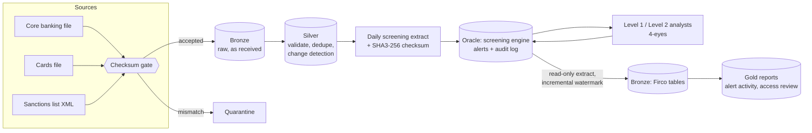

# Sanctions Screening Platform

An end-to-end sanctions-screening pipeline, built the way a bank runs one. Customer files from two source systems pass a checksum gate into a Delta lakehouse. Silver validates, dedupes and detects changes, and only new or changed people are handed to a screening engine in Oracle. Analysts work the alerts under a 4-eyes rule. The alert history comes back into the lakehouse for compliance reporting.

It runs on a laptop: Oracle Database Free in Docker, PySpark with Delta Lake, and a mock screening engine modelled on how Firco-style batch screening works. The data is synthetic; the sanctions list is Canada's public consolidated autonomous sanctions list. Every phase ends in an acceptance check, and all of them pass.

## Architecture



| Layer | What happens | Why it matters |
| --- | --- | --- |
| **Checksum gate** | Each file is matched against its checksum file: MATCH is accepted, MISMATCH or UNDETERMINED is quarantined, a missing checksum waits | A corrupted or half-transferred file never reaches the lakehouse |
| **Bronze** | Rows exactly as received, plus file name and run ID | Silver can always be rebuilt from bronze |
| **Silver** | Validation with every reason recorded; cross-source dedupe (one parent per person, lowest ID wins); NULL-safe change detection against the previous business day | Only about 1–3% of customers need screening on a normal day, not all of them |
| **Screening** | Strong rule (whole-name similarity ≥ 88) and weak rule (surname match + similarity ≥ 55); a full re-screen when the sanctions list changes | Catches existing customers the day they're sanctioned, not only new ones |
| **Workflow** | Level 1 clears or escalates the same day; Level 2 (always a different person) confirms the next business day; every action is appended to an audit log | The audit trail is the regulatory record |
| **Extract-back** | Small tables copied in full per day; the append-only audit log copied incrementally above a watermark; counts reconciled | Reporting never touches the operational database |
| **Gold** | Monthly alert activity; user access review with segregation-of-duties and inactive-access flags | What compliance actually reads |

## Results from a full simulated month

- **30 business days** ingested; 3 corrupted files quarantined and 1 file without a checksum held, all as designed.
- **Day 1:** 600 rows from both systems: 6 invalid, 166 duplicates, 428 distinct people screened. After that, 1–22 people a day.
- **Screening against the real list:** 63 alerts on day 1, of which 61 were cleared as false positives. Name screening is mostly false positives, which is why Level 1 triage exists.
- **All 5 planted true matches confirmed:** two on day 1, one new customer on the day they joined, and two long-standing customers caught by the **list-change re-screen** the day they were sanctioned.
- **Access review flags all four planted findings:** an inactive user still holding access, an administrator who also decides alerts (segregation of duties), a user with no profile, and a profile with no name.
- **Every acceptance check passes**, including re-running every day (nothing changes: the pipeline is idempotent) and comparing the Spark report row for row with the same SQL run directly on Oracle.

### Bugs the real database found

The screening phase was first tested on a SQLite + Parquet stand-in. The first run on real Oracle found three things the stand-in couldn't:

1. **Free-text dates of birth** on the real list (`1958 or 1959`, several dates in one field) overflowed the column, and the date comparison would have cleared a true match. Fixed by widening the columns and rewriting the comparison.
2. **Regime descriptions longer than 100 characters** overflowed the alert table. Fixed by sizing for the data, not the sample.
3. **`:start` is a reserved word for Oracle bind variables** (`ORA-01745`); SQLite accepts it. Fixed by renaming.

The lesson: profile reference data before sizing columns, and test on the target database.

## Controls

- **Least privilege:** the schema owner can't log in. The screening engine and the extract each have their own account; the extract account is read-only and can't see screening input.
- **Append-only audit log:** no account can update or delete it; the check proves it by trying.
- **4-eyes:** no alert is confirmed by the same person who escalated it; inactive users never act.
- **Reconciliation everywhere:** file rows = bronze rows; Oracle audit events = bronze audit events; every gap fails the run and is logged in a control table.
- **Secrets:** passwords live in `.env`, which is git-ignored and checked to be untracked.

## Run it

**Needs:** WSL2 Ubuntu (or Linux), Docker, Java 17, [uv](https://docs.astral.sh/uv/), make.

```bash
cp .env.example .env            # set the three Oracle passwords
uv venv --python 3.11 && uv pip install -r requirements.txt
make db-up                      # Oracle Free in Docker (first start: 5-10 min)
make db-init && make ctl && make check        # Phase 1: accounts, tables, control tables
make list && make generate && make check-p2   # Phase 2: sanctions list + 30 days of synthetic data
make ingest-all && make check-p3              # Phase 3: checksum gate + bronze
make silver-all && make check-p4              # Phase 4: silver + daily screening extract
make db-p5 && make firco-all                  # Phase 5: screening + analysts
make extract-firco && make reports && make check-p5
```

Each `check` prints PASS/FAIL per control and exits non-zero on any failure.

## Repository

```
sql/            Oracle: accounts and roles, screening tables, grants, Phase 5 changes
src/generator/  synthetic customers, planted matches, file anomalies, answer key
src/ingest/     checksum gate
src/silver/     validation, dedupe and change-detection rules
src/firco/      mock screening engine, name matching, simulated analysts
src/jobs/       one entry point per pipeline step
src/checks/     acceptance check per phase
src/common/     config, Spark session, Delta table helpers, Oracle connections
```

## Next: Azure

The same design on Azure: Oracle as the system of record; Azure Data Factory with a self-hosted integration runtime copying it into ADLS Gen2 in metadata-driven, watermarked batches; Azure Databricks with Unity Catalog for the lakehouse; the screening batch written back into Oracle; and a React + FastAPI workbench, signed in with Entra ID, where analysts decide alerts and managers read the reports. The silver rules and report code carry over unchanged; what changes is where the data lives and who orchestrates it.
